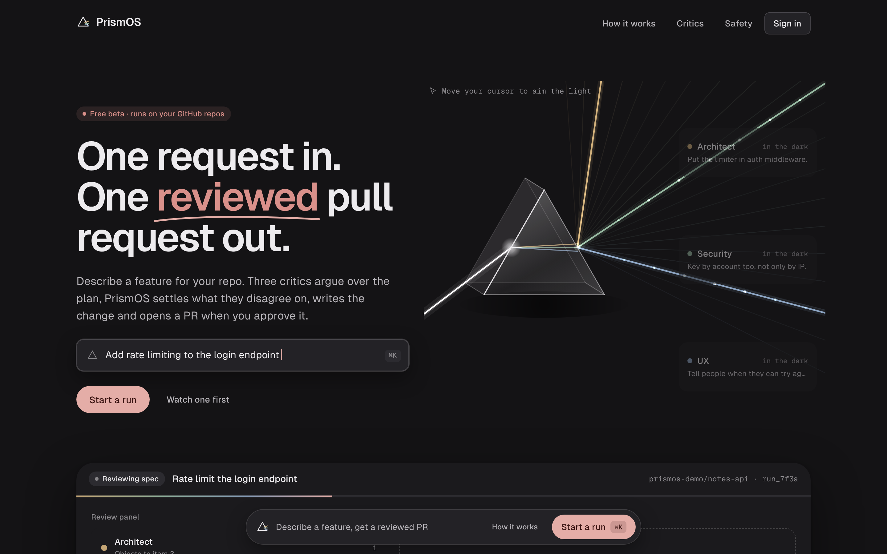
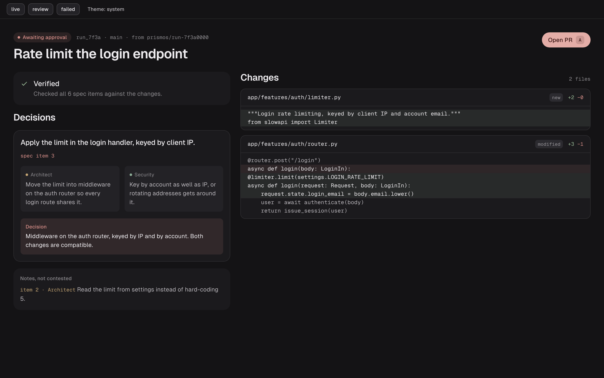
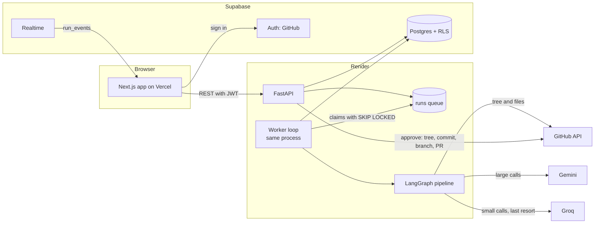
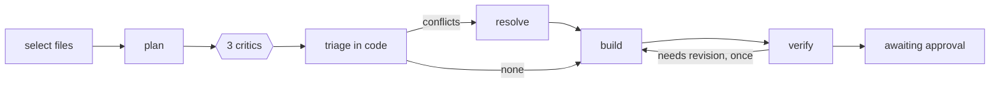

# PrismOS

Describe a feature for your GitHub repo. Three critics review the plan, real disagreements get settled, and
you approve the change before PrismOS opens a pull request. For solo developers and small teams adding
features to code that already exists.



**Live:** [prism-os-jade.vercel.app](https://prism-os-jade.vercel.app) · **[Try the demo](https://prism-os-jade.vercel.app/demo)** (read-only, no sign-up) · **Decisions:** [docs/decisions](docs/decisions) · **Case study:** [docs/case-study.md](docs/case-study.md)

## The problem

Asking a model for a feature gets you code that skips the part a reviewer would catch: where the change
belongs, how it can be abused, what the user sees when it fails. Running several "agents" usually doesn't help
either, because each gives its own opinion on its own text and nobody resolves anything. And once code is
written, it's up to you to turn it into a PR.

## What it does

- Reads your repo through a GitHub App installed only where you allow it, then picks the files a change touches.
- Writes a numbered spec. Architect, Security/QA and UX critics object to specific items, with a severity and a fix.
- Treats only real disagreements as conflicts: two critics on the same item, or one blocking objection. A
  resolver rules on each and says why; everything else is a note.
- Writes the change, checks it against the spec, revises once if needed, then waits for you.
- Opens one PR on a new branch when you approve. The body carries the spec, the decisions and the verdict.

Every step streams to the run page while it happens, and a run survives a refresh, a closed tab or a server restart.



## How it works



1. `POST /runs` stores a queued run and returns 202. Nothing runs in the request.
2. A worker in the API process claims it with `FOR UPDATE SKIP LOCKED` and keeps a heartbeat; a reaper requeues runs whose worker died.
3. The LangGraph pipeline runs: read repo → select files → plan → three critics in parallel → triage → resolve (only on conflicts) → build → verify (one revision at most). Each model call's output is cached in `run_steps`, so a retried run resumes at the step that failed.
4. Each step appends to `run_events`. The browser replays what it missed, then follows new rows over Supabase Realtime.
5. Approving commits the stored changes with the Git Data API (no clone) and opens the PR, idempotently.



## Engineering decisions

Full records, including what changed once the code met production, are in [docs/decisions](docs/decisions).

- **GitHub App, not the user's OAuth token.** Per-repo, revocable access with tokens minted per operation and
  scoped to one repo. Installation ids are guessable, so attaching a repo is only allowed when GitHub, asked
  with the user's own token, lists it. ([001](docs/decisions/001-github-app.md))
- **Conflicts are detected in code, not invented by prompts.** Two critics on one spec item, or a blocking
  objection. The rule is a pure function with full unit tests. ([003](docs/decisions/003-pipeline.md))
- **Postgres is the queue and the log.** Exactly-once claims, heartbeats, a reaper, resumable steps and an
  ordered event stream, with no extra service. ([004](docs/decisions/004-durable-runs.md))
- **Access is enforced in the database.** The anon key ships to the browser, so RLS checks membership on
  every table; the API checks again in SQL and never uses the service-role key. ([005](docs/decisions/005-auth-and-teams.md))
- **One module talks to models.** Validated JSON with one corrective retry, a fallback chain across Gemini and
  Groq, and provider refusals reported in plain words. ([002](docs/decisions/002-llm-providers.md))

## AI quality

From the first live run (adding an HTML/CSS landing page to a Bun + Hono booking API):

| | |
|---|---|
| Model calls | 8 (1 Groq, 7 Gemini) |
| Tokens | 16,481 in · 5,495 out |
| Model time | about 80 s, half of it the build step |
| Conflicts | 0 · 4 files changed · verified first time |
| Result | [PR #10](https://github.com/Elisabeth56/ridgewood-booking-api/pull/10) |

One run is not an evaluation. The planned harness (golden cases scored for file-selection recall@15, spec
coverage and verifier agreement, against a single-prompt baseline) is not built yet; see limitations.

## Tech stack

- **Web:** Next.js 16, React 19, Tailwind v4, Geist. One design system (`/styleguide`) in dark and light.
- **API:** FastAPI on Python 3.12, psycopg 3, Pydantic, LangGraph for the pipeline graph.
- **Data:** Supabase Postgres with RLS, Auth (GitHub) and Realtime.
- **Models:** Gemini Flash for large calls, Groq for small ones, both on free tiers through the OpenAI-compatible API.
- **Infra:** Vercel (web), Render (API and worker, Docker), GitHub Actions (CI, a keep-warm ping and Lighthouse).

The landing page scores 99 for performance and 100 for accessibility, best practices and SEO in mobile
Lighthouse on production (median of three runs; the `lighthouse` workflow re-measures it on every pull request that touches the web app).

## Run locally

Requires Node 22 with pnpm 10, Python 3.12+ with [uv](https://docs.astral.sh/uv/), and Docker for local Supabase.

```bash
pnpm install
cd apps/api && uv sync && cd ../..
pnpm db:start && pnpm db:reset      # local Supabase with the schema and the read-only demo account
cp apps/web/.env.example apps/web/.env.local
cp apps/api/.env.example apps/api/.env   # add GEMINI_API_KEY and GROQ_API_KEY
pnpm dev                            # web on :3000, API on :8000
```

Without GitHub App credentials the API reads public repos only and can't open PRs.

`pnpm lint`, `pnpm typecheck` and `pnpm test` run across both apps. API tests need a Postgres: set
`TEST_DATABASE_URL` (CI uses a `postgres:15` service with a small shim for Supabase's `auth` schema).

| Path | What it is |
|---|---|
| `apps/web` | Next.js app: landing, projects, runs, review |
| `apps/api/app/pipeline` | The graph, conflict rules, step cache and persistence |
| `apps/api/app/ai` | `llm.py` and the prompts |
| `apps/api/app/github` | App auth, repo reading, opening PRs |
| `supabase/migrations` | Schema, RLS, queue indexes |
| `docs/decisions` | Architecture decision records |

## Limitations and next steps

- **No eval harness yet**, so quality claims rest on tests and one live run. It's the next thing to build.
- **File selection is one model call over the tree.** Large monorepos need an index (pgvector, hybrid search).
- **Free-tier limits.** Gemini's free tier may use inputs for training, and daily request limits cap volume
  at roughly 200 runs a day. Bring-your-own-key is the fix.
- Teams exist in the data model, but there's no invite flow yet.

## Author

Elisabeth Nnamani · [github.com/Elisabeth56](https://github.com/Elisabeth56)
